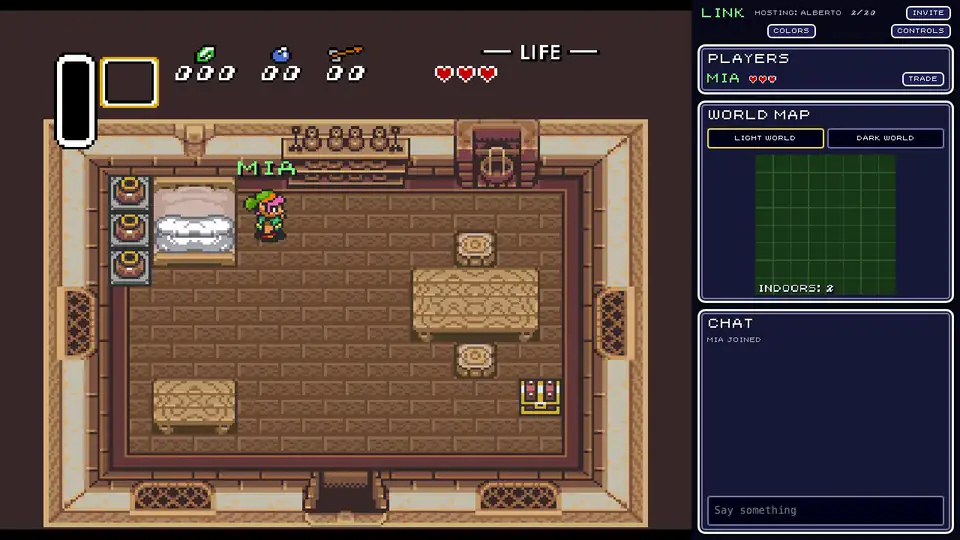
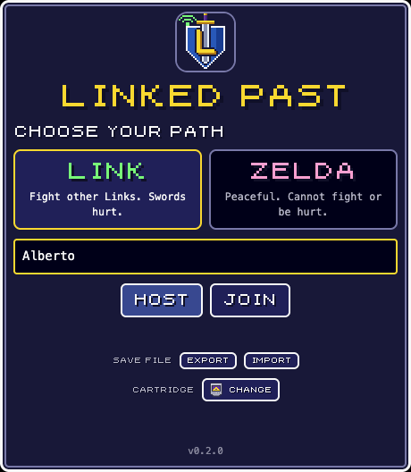
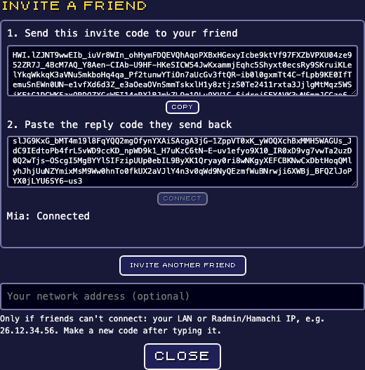
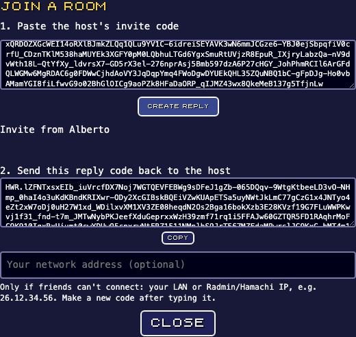

# Linked Past

**Play it at [linked-past.albertowd.dev](https://linked-past.albertowd.dev)**: bring your own ROM, nothing to install.



Multiplayer for *The Legend of Zelda: A Link to the Past*, played in the browser as an installable PWA. Each player has their own story and save, but everyone explores the same world: see friends on screen, fight or keep the peace, trade items, and chat.

**There is no game server.** One player hosts a room in their own browser, and friends on the same network join with an invite code.

**Bring your own cartridge dump.** Linked Past ships no ROM, graphics, or any other Nintendo data. Players pick their own `.sfc`/`.smc` file, which stays on their device. When someone joins, the host checks that they really have a supported ROM by asking for SHA-256 hashes of random slices of it. The host checks those answers against a bundled table of hashes, so nobody can join without one.

## What it does

- **Rooms in the browser, local network only.** One player clicks **Host**; their browser runs the room logic in a Web Worker, so it keeps going when the tab is in the background. It takes up to 20 players. Friends join with **invite codes**, and no internet connection is used at any point.
- **Your own story.** Every player has their own save, kept on their device (one per cartridge). You can export and import it as an `.srm` file from the start screen.
- **Shared world.** Players in the same zone (overworld light/dark, or the same dungeon room) see each other on screen. Every player also appears on the world map in the right-hand column.
- **Two modes, chosen on the start screen:**
  - **Link:** sword hits hurt other Link-mode players. Damage goes through the game's own damage path (`$0373`), so you get real knockback, invincibility frames and Game Over.
  - **Zelda:** peaceful. Can't attack and can't be hurt.
- **Trading.** Both modes can trade rupees, bombs, arrows and bottle contents (potions, fairies, bees) with a nearby player. The host holds trades in a two-phase escrow (debit both sides, then credit both sides) and refunds if anything fails.
- **Ghosts.** During cutscenes, dialogs, menus and transitions (or when your tab is hidden), you appear to others as a pale ghost. Ghosts can't fight or trade.
- **Chat.** Shown in the column to the right of the 4:3 game screen.
- **In-game look.** Everything is drawn with the game's own art, read from the player's ROM at runtime:
  - Fonts, digits, hearts, and rupee/bomb/arrow icons come out of VRAM after a quick headless boot.
  - Other players are drawn with their *actual* current sprite, captured from OAM/VRAM/CGRAM, including tunic colour, sword and shield.
- **Localized UI.** The UI language follows the cartridge region. Catalogs are plain JSON in `src/locales/`, and a test enforces that every locale has every key.

| ROM (unheadered or headered) | SHA-1 | UI |
| --- | --- | --- |
| USA | `6d4f10a8…2973` | English |
| Europe (PAL) | `7c073a22…da895` | English |
| Canada | `c1c6c7f7…aa100` | French |
| France (PAL) | `229364a1…987cc` | French |
| Germany (PAL) | `2e624949…c6559` | German |

All five share the same WRAM layout, which was checked with a headless harness covering boot, movement, damage and inventory writes. Players on different regions can play together; PAL players run at 50 Hz.

## How connecting works

1. The host clicks **Invite** and sends the invite code to a friend in any way: a chat app, a message, or even typed by hand.
2. The friend clicks **Join**, pastes the code, and sends back the **reply code** the app shows.
3. The host pastes the reply. The two browsers connect directly with WebRTC, end-to-end encrypted. Do this once per friend; several invites can be open at once.

| Start screen | Host: invite | Friend: join |
| --- | --- | --- |
|  |  |  |

WebRTC runs with **no STUN/TURN servers**, so only local addresses are used and nothing leaves your network. The codes are compressed WebRTC session descriptions, usable once and only by the two of you.

The goal is play on a **local network**. **Radmin VPN / Hamachi** work as a virtual local network for friends who are far away. Browsers hide local IPs behind random `.local` names, which usually resolve on a real LAN but may not across a VPN. If friends can't connect, type your Radmin/Hamachi IP into **Your network address** before making the code. That adds the real IP to the code, and I haven't tested it on a real Radmin network yet.

If the host closes the room, guests are told, and they rejoin with a new invite code.

## Layout

```
emulator/        snes9x (libretro) + frontend.cpp -> WebAssembly core exposing WRAM/VRAM/OAM/CGRAM
src/shared/      game core: RAM map, protocol, rules, pose codec, delta streams, World (room)
                 and HostCore; no DOM code, so its tests run in Node
src/             the PWA: emulator loop, sprite capture/overlay, UI, WebRTC host/guest links
test/            node:test suites (test/shared for the core)
public/          icons, plus the built emulator core in public/core (committed, so static hosts
                 that build from git serve it)
scripts/         core build, ROM challenge table generator, SonarQube helpers
```

## Run it

Requirements: Node 22+. Docker is optional, needed only to build the emulator core without a local emsdk, or for SonarQube.

```sh
npm install
npm run core:build     # optional: rebuilds the committed public/core/linked-past-core.{js,wasm}
npm run dev            # http://localhost:5173 (localhost counts as secure)
```

### Play with friends

| How | Command | Friends open |
| --- | --- | --- |
| **From the host's PC** (LAN, Radmin, Hamachi), recommended | `npm run lan` serves the build at `https://<your-ip>:8443` with a self-signed certificate | `https://<host-ip>:8443`, accepting the certificate warning once |
| **Static HTTPS host** | `npm run build`, then upload `dist/` to any static host (GitHub Pages, Cloudflare Pages…). For a sub-path, use `BASE=/linked-past/ npm run build`. | the site URL. Internet is only needed to load the app; once installed as a PWA it also opens offline |

The ROM check, audio, gamepads and offline install all need HTTPS (a "secure context"), which is why the LAN option serves HTTPS instead of plain HTTP. The build contains no Nintendo data, only the app, the emulator core and the hash table.

Controls: the first time you play, a Controls screen opens. It lists what every button does and lets you rebind any keyboard key or gamepad button; press F1 or use the header button to reopen it.

Default keys:
- Arrow keys: move
- Z: B (sword)
- X: A (talk, lift)
- A: Y (item)
- S: X (map)
- Enter: Start
- Right Shift: Select
- T: chat

On phones and tablets there's an 8-way D-pad and SNES-coloured A/B/X/Y buttons you can slide your thumb across. In landscape they sit beside the game and the sidebar opens as a drawer (☰). Their size, and whether they show at all, is set on the Controls screen.

### ROM ownership challenges

`src/shared/data/rom-challenges.json` holds 512 `(offset, length, sha256)` entries per supported ROM. It contains no ROM bytes, and only a hosting browser loads it. To regenerate it from your own dumps:

```sh
npm run rom:challenges -- dump/*.sfc
```

## Quality

```sh
npm test                # unit tests in every workspace (node:test + tsx)
npm run test:coverage   # all tests + coverage/lcov.info for SonarQube
npm run typecheck
npm run lint            # Biome lint + format check (npm run lint:fix to apply)
npm run sonar           # SonarQube scan (see below)
```

What the tests cover:
- **shared** (`test/shared`):
  - RAM decoding, cutscene and zone rules, combat and trade rules, and the pose codec.
  - Change-only delta streams.
  - The room logic (PvP cooldowns, spin attacks, trade escrow with refunds and expiry, chat filtering).
  - `HostCore`: ROM proofs, version checks, full rooms, duplicate names.
- **web:** sprite capture, glyph harvesting, RAM writes, font folding, catalog completeness, control bindings and D-pad maths.

Browser-only modules (frame loop, audio, WebRTC links, DOM screens) are verified end to end with Playwright instead and are excluded from coverage in `sonar-project.properties`.

### SonarQube

`npm run sonar` runs `scripts/sonar.sh`, which:
1. Starts SonarQube Community from the `sonar` compose profile on http://localhost:9000.
2. On first run, generates a random admin password and an analysis token, both kept in the gitignored `.sonar/` folder.
3. Regenerates coverage, runs the scanner container, and marks the reviewed false positives listed in `scripts/sonar-false-positives.mjs`, each with its justification.
4. Prints the quality gate result and any open issues.

Log in as `admin` with the password from `.sonar/admin-password`.

```sh
npm run sonar:up     # start only SonarQube (provisioned on first start)
npm run sonar        # scan; starts SonarQube first if needed
npm run sonar:down   # remove SonarQube with its data and .sonar/ credentials (it's a throwaway local instance)
SONAR_PORT=9001 npm run sonar:up   # if port 9000 is taken, e.g. by another project's SonarQube
```

## Notes and limits

- **The host has the final say, but only in its own room.** Each player runs their own emulator, so a modified client could still cheat its own game. The host checks sword reach and trade amounts for everyone else.
- **Keep the host's tab open.** The room lives there: it keeps running in the background thanks to the worker, but closing the tab ends it.
- **Equipment can't be traded.** That covers swords, mail and quest items, so trades can't break story progression.
- **No automatic reconnect.** Without any server there's nobody to redo the handshake, so after a disconnect a guest needs a new invite code.
- **Older versions:** the AWS-hosted version (accounts, cloud saves, Lambda + Fargate) is preserved on the `aws-server` branch.
- **snes9x license:** snes9x is distributed under its own non-commercial license. See `emulator/snes9x-src/LICENSE` after building.

## Disclaimer

Linked Past is an unofficial fan project and is not affiliated with or endorsed by Nintendo. *The Legend of Zelda* and *A Link to the Past* are trademarks of Nintendo.
